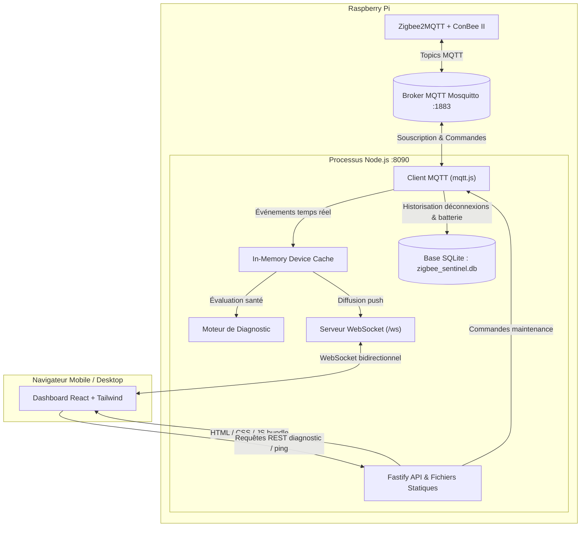
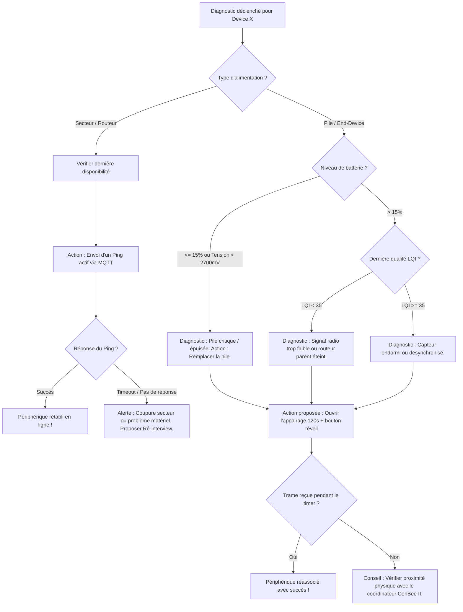

# Spécification Technique & Design : Zigbee Sentinel

**Date** : 2026-10-23  
**Statut** : Validé par l'utilisateur  
**Auteur** : Antigravity & Nabil  
**Projet** : Zigbee Sentinel — Application de surveillance, diagnostic et reconnexion de périphériques Zigbee  

---

## 1. Contexte & Objectifs

L'utilisateur dispose d'une installation domotique basée sur **Jeedom** hébergée sur un **Raspberry Pi**, gérant un réseau Zigbee via le coordinateur **ConBee II** et le service **Zigbee2MQTT**.

### Problématique
Dans un réseau domotique sans fil Zigbee, certains périphériques (capteurs sur pile, prises, ampoules) peuvent se déconnecter ou cesser d'émettre (pile épuisée, perte de portée, routeur intermédiaire éteint, plantage firmware). L'interface standard de Jeedom n'offre pas toujours une visibilité immédiate, centralisée et proactive sur l'état de santé radio, les niveaux de pile et les actions rapides de dépannage.

### Objectifs de la solution
1. **Supervision temps réel** : Dashboard clair et réactif recensant tous les périphériques Zigbee, leur statut de connectivité (`En ligne` / `Hors-ligne`), leur niveau de batterie et leur qualité radio (LQI).
2. **Diagnostic intelligent & Reconnexion guidée** : Identifier la cause probable de déconnexion selon le type de périphérique (secteur vs pile) et proposer des actions correctives (Ping forcé, ré-interview, ouverture temporaire de l'appairage *permit_join*).
3. **Historique & Alertes de santé** : Enregistrement de l'historique des batteries et du journal des déconnexions/reconnexions dans une base locale légère.
4. **Empreinte minimale** : Application monolithique légère (Node.js/Fastify + React SPA + SQLite) exécutable sur le Raspberry Pi sans surcharger les ressources partagées avec Jeedom.

---

## 2. Architecture Globale



---

## 3. Modèle de Données & SQLite

Le moteur de stockage utilise **`better-sqlite3`**, une bibliothèque C synchrone et ultra-rapide ne générant quasiment aucune surcharge mémoire ni thread concurrent.

### Schéma des tables

```sql
-- Périphériques enregistrés et dernier état
CREATE TABLE IF NOT EXISTS devices (
    ieee_address TEXT PRIMARY KEY,
    friendly_name TEXT NOT NULL,
    type TEXT NOT NULL, -- 'Router' ou 'EndDevice'
    model TEXT,
    vendor TEXT,
    power_source TEXT, -- 'Battery' ou 'Mains'
    status TEXT NOT NULL DEFAULT 'offline', -- 'online' ou 'offline'
    battery INTEGER, -- 0-100 ou NULL si secteur
    linkquality INTEGER, -- LQI 0-255
    last_seen INTEGER, -- timestamp epoch ms
    created_at INTEGER NOT NULL,
    updated_at INTEGER NOT NULL
);

-- Historique de niveau de batterie (pour courbes et détection de chute anormale)
CREATE TABLE IF NOT EXISTS history_battery (
    id INTEGER PRIMARY KEY AUTOINCREMENT,
    ieee_address TEXT NOT NULL,
    battery INTEGER NOT NULL,
    recorded_at INTEGER NOT NULL,
    FOREIGN KEY(ieee_address) REFERENCES devices(ieee_address) ON DELETE CASCADE
);

-- Journal des changements d'état (déconnexions / reconnexions)
CREATE TABLE IF NOT EXISTS history_events (
    id INTEGER PRIMARY KEY AUTOINCREMENT,
    ieee_address TEXT NOT NULL,
    event_type TEXT NOT NULL, -- 'connected', 'disconnected'
    recorded_at INTEGER NOT NULL,
    duration_offline_ms INTEGER, -- Renseigné lors de la reconnexion
    FOREIGN KEY(ieee_address) REFERENCES devices(ieee_address) ON DELETE CASCADE
);

-- Journal des actions de maintenance et diagnostics
CREATE TABLE IF NOT EXISTS diagnostic_logs (
    id INTEGER PRIMARY KEY AUTOINCREMENT,
    ieee_address TEXT NOT NULL,
    action_type TEXT NOT NULL, -- 'ping', 'interview', 'permit_join', 'diag_run'
    status TEXT NOT NULL, -- 'success', 'pending', 'failure'
    details TEXT, -- JSON ou message explicatif
    recorded_at INTEGER NOT NULL,
    FOREIGN KEY(ieee_address) REFERENCES devices(ieee_address) ON DELETE CASCADE
);
```

---

## 4. Ingestion MQTT & Intégration Zigbee2MQTT

Le service se connecte au broker Mosquitto local (`MQTT_URL`, par défaut `mqtt://127.0.0.1:1883`) avec un préfixe paramétrable (`Z2M_BASE_TOPIC`, par défaut `zigbee2mqtt`).

### Topics souscrits :
1. `${Z2M_BASE_TOPIC}/bridge/devices` :
   * Contient la liste exhaustive des périphériques déclarés, leur adresse IEEE, leur type matériel (`Router` ou `EndDevice`), description et fabricant.
2. `${Z2M_BASE_TOPIC}/bridge/state` & `${Z2M_BASE_TOPIC}/bridge/info` :
   * Indique si Zigbee2MQTT est actif (`online` / `offline`), la version, et l'état de santé du coordinateur ConBee II.
3. `${Z2M_BASE_TOPIC}/+` :
   * Chaque périphérique publie son état sous son `friendly_name` (ou adresse IEEE). Payload JSON type :
     ```json
     {
       "battery": 87,
       "voltage": 2980,
       "linkquality": 112,
       "temperature": 21.4,
       "humidity": 48.2
     }
     ```
4. `${Z2M_BASE_TOPIC}/+/availability` :
   * Message direct `online` ou `offline` publié par le module d'availability de Zigbee2MQTT.
5. `${Z2M_BASE_TOPIC}/bridge/response/#` :
   * Retours asynchrones des requêtes de commande (ping, permit_join, interview).

### Topics de publication (Actions de maintenance) :
* **Ping** : `${Z2M_BASE_TOPIC}/<friendly_name>/get` avec `{"state": ""}` ou `${Z2M_BASE_TOPIC}/bridge/request/device/ping` avec `{"id": "<friendly_name>"}`.
* **Ré-interview** : `${Z2M_BASE_TOPIC}/bridge/request/device/interview` avec `{"id": "<friendly_name>"}`.
* **Permit Join** : `${Z2M_BASE_TOPIC}/bridge/request/permit_join` avec `{"value": true, "time": 120}`.

---

## 5. Moteur de Diagnostic & Arbre de Résolution

Le moteur de diagnostic évalue l'état d'un périphérique selon des règles déterministes :



### Données synthétisées dans le rapport de diagnostic :
* **Verdict principal** : Phrase claire résumant la cause la plus probable (*"Pile critique à remplacer"*, *"Perte de portée radio"*, *"Coupure d'alimentation secteur"*).
* **Métriques clés** : Dernière activité, niveau de batterie estimé, score de signal LQI, statut du maillage environnant.
* **Action corrective en 1 clic** :
  * Si routeur : Bouton *Ping forcé* et bouton *Ré-interview*.
  * Si capteur pile : Bouton *Ouvrir l'appairage (2 min)* avec guide visuel : *"Faites un appui bref sur le bouton d'association du capteur pour forcer l'émission d'une trame"*.
* **Détection automatique de rétablissement** : La fenêtre de diagnostic écoute le WebSocket et affiche immédiatement un badge vert de confirmation dès que la reconnexion est opérée.

---

## 6. Interface Utilisateur (React SPA)

### Composants principaux
1. **`Header`** :
   * Statut du coordinateur ConBee II, du bridge Z2M et du broker Mosquitto.
   * Compteurs badges : Total, En ligne, Hors-ligne, Piles < 20%.
   * Bouton global *Permit Join* avec timer progressif.
2. **`FilterToolbar`** :
   * Champ de recherche textuelle (filtrage instantané).
   * Boutons de filtres : `Tous`, `Hors-ligne`, `Batterie faible`, `Routeurs`, `Capteurs`.
3. **`DeviceCard`** :
   * Nom (`friendly_name`), modèle, icône de catégorie (ampoule, thermomètre, prise, capteur d'ouverture, etc.).
   * Badge de statut (`En ligne` vert / `Hors-ligne` rouge).
   * Jauge de batterie avec couleur contextuelle (vert > 50%, orange 20-50%, rouge <= 20%) ou icône secteur.
   * Qualité du signal radio (barres de signal LQI).
   * Date/heure relative de dernière vue (*"il y a 4 min"*).
   * Boutons d'actions rapides (Ping, Interview, Diagnostiquer).
4. **`DiagnosticModal`** :
   * Assistant interactif pas-à-pas avec feedback en temps réel.
5. **`HistoryDrawer / HistoryView`** :
   * Journal chronologique des incidents et déconnexions passées.
   * Historique de la batterie sous forme de mini-graphique SVG.

---

## 7. Déploiement & Environnement Raspberry Pi

### Configuration par variables d'environnement (`.env`)
```bash
PORT=8090
MQTT_URL=mqtt://127.0.0.1:1883
MQTT_USERNAME=
MQTT_PASSWORD=
Z2M_BASE_TOPIC=zigbee2mqtt
DATABASE_PATH=./data/zigbee_sentinel.db
HISTORY_RETENTION_DAYS=60
```

### Docker multi-stage
```dockerfile
# Stage 1: Build Frontend
FROM node:20-alpine AS builder
WORKDIR /app
COPY package*.json ./
RUN npm ci
COPY . .
RUN npm run build

# Stage 2: Production Runtime
FROM node:20-alpine
WORKDIR /app
ENV NODE_ENV=production
COPY package*.json ./
RUN npm ci --omit=dev
COPY --from=builder /app/dist ./dist
COPY --from=builder /app/server ./server
EXPOSE 8090
CMD ["node", "server/index.js"]
```

### `docker-compose.yml`
```yaml
version: '3.8'
services:
  zigbee-sentinel:
    image: zigbee-sentinel:latest
    container_name: zigbee-sentinel
    restart: unless-stopped
    network_mode: host
    environment:
      - PORT=8090
      - MQTT_URL=mqtt://127.0.0.1:1883
      - Z2M_BASE_TOPIC=zigbee2mqtt
      - DATABASE_PATH=/app/data/zigbee_sentinel.db
    volumes:
      - ./data:/app/data
```

---

## 8. Mode Simulation / Mock (Développement sans matériel requis)

Pour permettre le développement et la validation complète de l'application sans dépendre d'une connexion immédiate au Raspberry Pi physique :
* Un script de mock (`npm run dev:mock` ou variable `MOCK_MQTT=true`) lance un simulateur de broker Zigbee2MQTT émettant un jeu réaliste de périphériques :
  * 1 prise routeur connectée
  * 1 prise routeur hors-ligne (coupée)
  * 2 capteurs de température (dont 1 avec pile faible à 12%)
  * 1 capteur de présence déconnecté depuis 24h
* Le simulateur répond aux requêtes de Ping, de Ré-interview et de Permit Join pour valider le comportement de l'assistant de diagnostic en direct.

---

## 9. Plan de Vérification & Tests

1. **Tests unitaires (`npm test`)** :
   * Parsing des trames Z2M (`bridge/devices`, availability, payloads métriques).
   * Moteur de diagnostic : validation des règles pour routeurs vs capteurs sur pile.
   * Opérations de base de données SQLite : insertion, mise à jour, purge de rétention.
2. **Vérification du mode simulation (`npm run dev:mock`)** :
   * Connexion WebSocket navigateur.
   * Affichage instantané du dashboard.
   * Déclenchement du diagnostic sur un équipement hors-ligne et simulation de reconnexion.
3. **Build & Packaging Docker** :
   * Vérification du build `npm run build`.
   * Vérification de la création de l'image Docker multi-stage.
